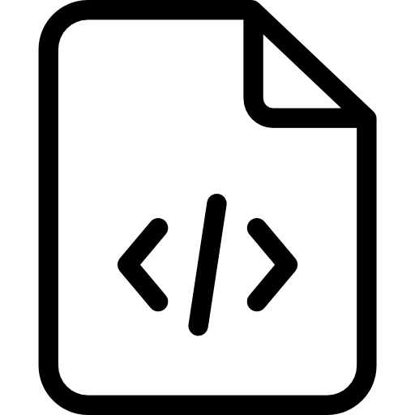

<!--
  Editable page copy for the Arbiter visualiser.

  Each block below is keyed by a `## key` heading that matches a data-md="key"
  attribute in index.html. The loader in index.html fetches this file, splits on
  the `## key` headings, and injects each block's text into the matching element.

  Formatting: **bold**, *italic*, and `code` work. Raw inline HTML is also
  passed through untouched (used for the ARBITER acronym's per-letter bold and
  the coloured "Accepted"), so you can keep or edit those tags directly.

  Edit the prose freely; do NOT rename the `## keys` (they wire to the page).
-->

## title
Arbiter: Sample-Efficient Test-Time Scaling with an Agentic Verifier

## teaser-cap
**gpt-oss-120b, refined against Arbiter, clears the IOI 2026 gold-medal line at a fraction of the tokens compared to parallel scaling.** The chart plots contest score against total tokens spent. Refinement reaches **385.46** (gold), while plain sampling tops out at 374. Hover for exact values.

## verifier
Prior attempts at IOI-level competitive programming scale test-time compute in parallel: overgenerate, then search. 
<a href="https://storage.googleapis.com/deepmind-media/AlphaCode2/AlphaCode2_Tech_Report.pdf" target="_blank" rel="noopener">AlphaCode</a> drew up to a million candidate programs per problem and distilled them to ten submissions with filtering and clustering. 
OpenAI's <a href="https://arxiv.org/abs/2502.06807" target="_blank" rel="noopener">o1-ioi</a> sampled 10,000 solutions per subtask at IOI 2024, then picked 50 with clustering and a learned reranker. 
NVIDIA's <a href="https://arxiv.org/abs/2510.14232" target="_blank" rel="noopener">GenCluster</a> reached the IOI 2025 gold line by drawing 5,000 solutions per subtask from gpt-oss-120b and selecting 50 through behavioral clustering and a tournament. The paradigm works the way gold panning works: scoop blind, sift everything, keep the rare fleck that glitters. How can we do better than search?

## paradigm-cap
Search spends compute across candidates. Verifier feedback spends it along improving trajectories.

## verifier-refinement
**Arbiter** (<b>A</b>gentic <b>R</b>einforcement-learned <b>B</b>ug-finding <b>I</b>nteractive <b>T</b>est <b>E</b>xamine<b>R</b>) hands the solver a metal detector instead. It reads the problem and one candidate, decides Accept or Reject, and on rejection returns a diagnosis plus a concrete input that breaks the code. That input is a bearing on where to dig next. A solver refining against that signal corrects its prior mistake instead of redrawing from scratch, so the compute goes into revising one chain deeper rather than widening the pool. 

## verifier-flow-cap
**Arbiter returns evidence where a judge returns only a score.** It sees only the problem and one candidate, with no test data and no checker. It probes the candidate in a sandbox and returns a verdict, a diagnosis, and a failing input. Click the inputs or the verifier box for the real example.

## environment
Beyond IOI, Arbiter is an example of **environment engineering**. A typical coding environment is built to ensure correctness and nothing more: it scores what the model did, and the score is where the interaction ends. We design the environment to also carry signal. Every rejection arrives with a diagnosis and a replayable counterexample, so the model has something concrete to improve from. Because that feedback comes from the verifier rather than the judge, querying it spends no submissions and exposes no hidden tests. The same signal can drive RL training and test-time refinement alike.

## training
**Base model & RL loop.** Arbiter is trained from **Qwen3.6-35B-A3B** with **GRPO**-style group-normalized advantages in an asynchronous agentic-RL loop. The verifier is trained in a sandbox environment with two tools (`execute_code`, `execute_command`) and no judge access. It can compile the candidate code solution and probe it on inputs of its own devising, but must commit to a verdict on its own evidence. Adjudication happens only after the episode ends, when the candidate is re-hosted on a live judge and the submitted hack is replayed against it. This keeps the training signal unmetered and leak-free.
  
**Training data.** We mine training data from a strong solver's RL rollouts and sample it down to **20K submissions across 6,145 ICPC and Codeforces problems predating 2026**, under a score-stratified quota. The near-miss band (score 76–99) gets the largest share at **40%**, since a solution that fails a single subtask cannot be broken by a careless input and forces the verifier to actually read the code. Every label is a live judge verdict. The pool is deduplicated by code content, capped per problem, and kept disjoint from every evaluation problem, with a separate hard validation set (100 problems, 400 candidates) to pick checkpoints.

## training-reward
**Reward design.** Every Arbiter output includes a verdict (AC/no-AC), a diagnosis and a hack. Rewarding only the verdict makes the reward easily gamable due to label imbalance, and the model quickly degenerates. Rewarding the diagnosis is hard due to its free-form text nature. Thus our reward heavily relies on the verifiability of the hack.

## training-cap-reward
**The layered-funnel reward.** A rejection earns the bulk of its credit only once the counterexample lands a legal break. Both branches top out at **1.00**, and a break the judge missed adds **+0.10**. The diagnosis is never rewarded and can only cost. Click the controls above to build up each scenario.

## training-cap-pool
**Where the 20K training candidates come from.** Left: our sampling quota by score band. Right: the judge verdicts it produced. The near-miss band (76–99) is the only one that fans out to every verdict, which is what forces the verifier to read the code. Hover any ribbon or bar for exact counts.

## training-funnel
The reward is a **layered funnel** built to make evidence cheaper to produce than to fake, with three-quarters of it sitting at the one step that cannot be faked: a validator-legal input that actually breaks the candidate. Guessing "rejected" and submitting garbage therefore caps an order of magnitude below a verified break.
  
**Length penalty.** Late in training, responses balloon until episodes die to timeouts rather than to wrong verdicts. The fix, adopted from <a href="https://arxiv.org/abs/2602.02276" target="_blank" rel="noopener">Kimi K2.5</a>, is a length penalty applied in alternating phases against a relative budget, the 75th percentile of length within each group's best-reward tier. Under it, response length comes down while reward keeps rising.

## training-cap
**The length penalty shortens responses without costing reward.** One run, continued two ways. The only difference is the penalty in the shaded windows, and under it length and abort rate fall while reward holds. The baseline stops near step 200, where half its runs were aborting. Solid lines are 5-step averages, faint ones raw.

## results
Refinement is only as good as the verifier behind it. We measure Arbiter's judging quality directly on two complementary benchmarks. 
  
- <a href="https://arxiv.org/abs/2606.12864" target="_blank" rel="noopener"><b>UOJ-Bench</b></a> is an existing public hacking benchmark: every candidate is known to be wrong (479 Easy / 1,046 Hard), so it probes depth against covert bugs that survive an official test suite. 
  
- <a href="https://huggingface.co/datasets/n-alignment/USACO-Judge" target="_blank" rel="noopener"><b>USACO-Judge</b></a> is a benchmark we built from the held-out 2026 USACO contests: 900 candidates (270 Easy / 630 Hard) over 39 problems spanning Bronze through Platinum, balanced at one correct solution for every two wrong ones, so a verifier must accept correct code as well as break wrong code. Candidates come from five model families plus five human competitive programmers, and every label is a live judge verdict on expert-authored validators and checkers.
  
The table ranks models by hack success: the share of wrong candidates broken with a legal generated input, split Easy/Hard on each benchmark. Training does the heavy lifting. On UOJ-Bench Easy, the same 35B backbone breaks **16.7%** of candidates untrained, **41.3%** with an agentic scaffold, and **61.5%** after RL. That places Arbiter **above DeepSeek-V4-Pro, a model 45× its size, on every split**. 

## results-cap
**Hack success rate (%)** on UOJ-Bench and USACO-Judge, by difficulty split (Easy / Hard). **↑** higher is better; **bold** = best in column. Grouped by inference mode: non-agentic (⚡, single-shot) versus agentic (⚙, tool-using). Arbiter (35B) rivals models up to ~45× larger.

## refinement
On IOI 2026 itself, **gpt-oss-120b** attempts every subtask, drawing **50** seed solutions each. **Arbiter** reviews every candidate. An <b style="color:var(--sub-ok)">Accepted</b> verdict sends the program to the judge and retires its trajectory. A rejection returns feedback that the solver revises against in the next round, under a **5-round budget**. A trajectory that never earns an accept submits its final revision instead, so the verifier decides both what to fix and when to stop. The climb is also cheap: where GenCluster drew **5,000** solutions per subtask, refinement reaches gold on fewer than **100** generations per subtask on average, under two rounds of revision. Capping refinement at round **R** shows how quickly the feedback pays off.

## refinement-cap
**One round of refinement does most of the work.** The line caps refinement at round **R**: a single round of Arbiter feedback lifts the score **240.49 → 356.91**, and R4 clears gold at **385.46**. Refinement by real OJ score uses a **50-submission budget** and only achieves **334.6**. The bars count trajectories still active each round, falling from **50** seeds to **7** as accepted solutions retire. Hover for exact values.

## artifacts
Every score above is backed by its raw data. Click a subtask to open its fan of 50 trajectories, then any node for the verifier's full turn-by-turn review, or the  icon for the program that round submitted and the reasoning that wrote it. The badge beside a problem's score opens its merged final submission.
